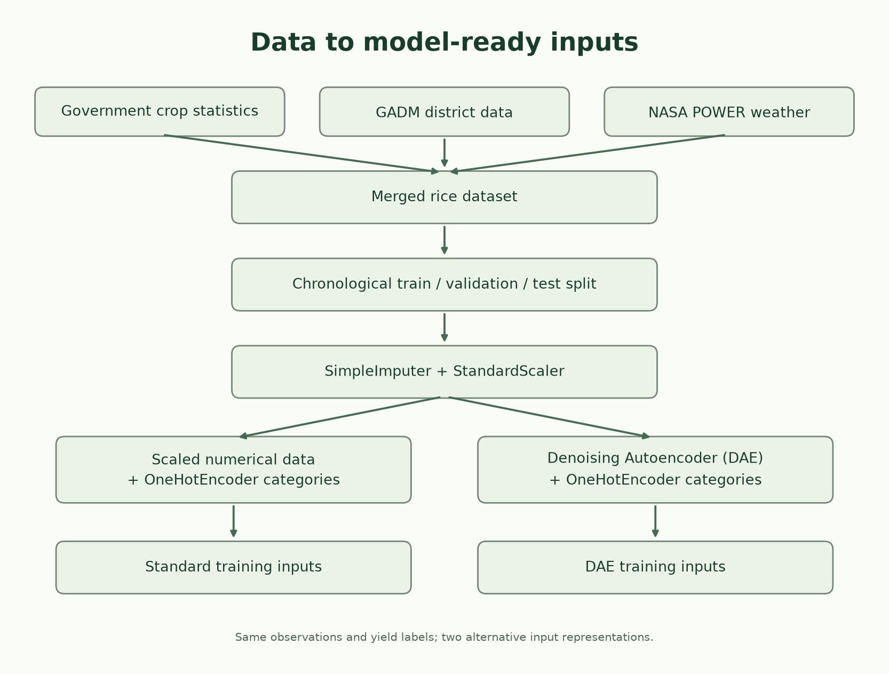
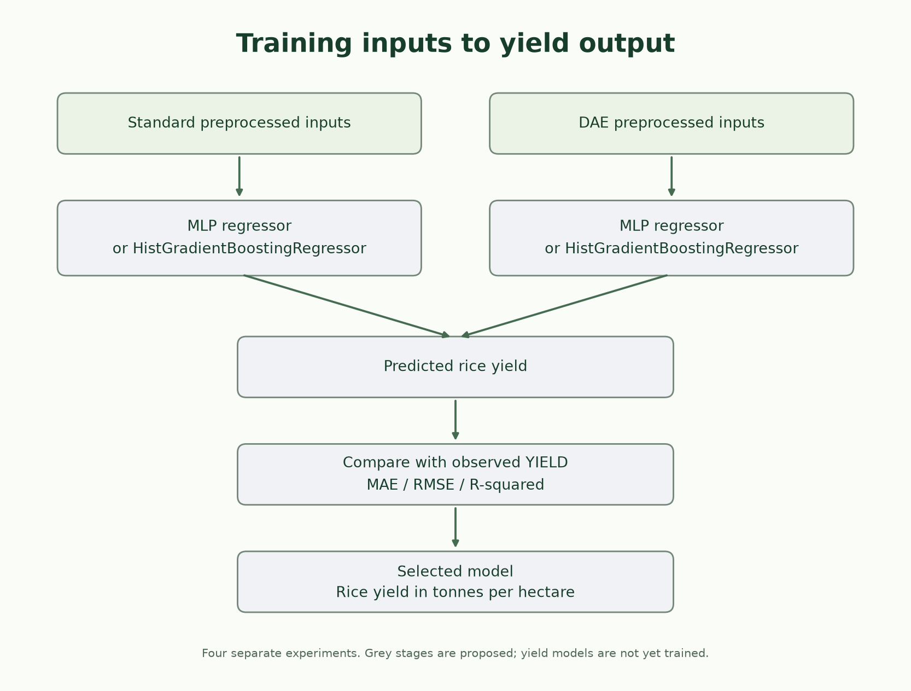
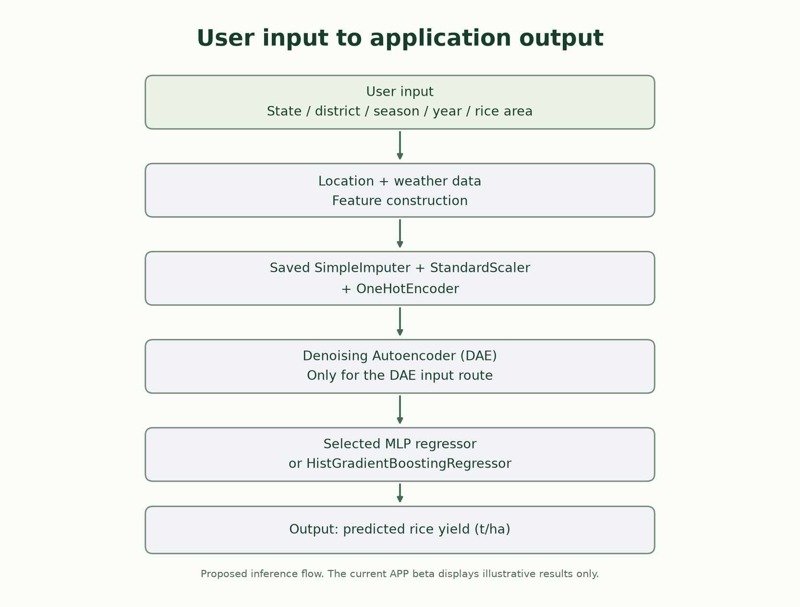

# South India Rice Yield Prediction

District-season rice yield estimation using government crop statistics, GADM
district locations and NASA POWER weather. This repository includes preserved
source data, one merged master, two model-ready representations, fitted
Denoising Autoencoder preprocessing, proposed yield model definitions and a
green/off-white demonstration app.

**Team:** R Ritwik (23BAI0037) and Joshith G (23BAI0075).

**Current scope is yield prediction, not crop disease detection.** There are no
disease labels or crop images. Low estimated yield cannot establish disease.

## Start here

- [Faculty proposal](docs/Preprocessing_Proposal.pdf): sources, features, preprocessing and model plan.
- [Project architecture diagrams](docs/architecture/README.md).
- [Detailed source selection and merge](docs/figures/Raw_Data_Feature_Selection_and_Merge.svg).
- [Complete preprocessing notebook in Colab](https://colab.research.google.com/github/ritwik1612/south-india-crop-yield-dataset/blob/main/pre-processing/Crop_Preprocessing.ipynb).
- [Beta application](APP/prototype/README.md) and [model registry](docs/MODEL_REGISTRY.md).
- [Changelog](CHANGELOG.md).

## What works now

| Component | Status |
| --- | --- |
| Source-derived master and chronological splits | Built and verified |
| SimpleImputer, StandardScaler and OneHotEncoder | Fitted on training observations |
| Denoising Autoencoder (DAE) | Fitted; checkpoint and learned features included |
| MLP and HistGradientBoostingRegressor | Definitions included; supervised training not performed |
| LSTM and 1D CNN | Definitions included; sequence preparation and training are future work |
| Verdant beta | Working static presentation interface; explicitly illustrative results |
| Yield accuracy improvement | Not established; requires the proposed experiments |



## Repository layout

```text
APP/
  prototype/                 Static beta frontend
  models/                    Tabular and temporal yield model definitions
DATASET/
  raw/                       Government, boundary CSVs and daily weather
  merged/                    rice_master.csv
  training/
    standard/                Conventional train, validation and test CSVs
    autoencoder/             DAE train, validation and test CSVs
    manifest.json            Exact allowed predictors and target
pre-processing/              Pipeline, visible-code notebook and saved transforms
docs/
  architecture/              Editable vector diagrams and PNG previews
  figures/                   Actual EDA and preprocessing plots
  preprocessing/             Run history, comparisons and validation evidence
  presentations/             Dataset feature-transition decks
  reference_papers/          Reference PDFs
  source/                    Document and diagram source files
```

Temporary builds, caches, nested Git checkouts and historical local archives are
not part of this published workflow.

## Original datasets and provenance

There are **three source families**, not a collection of independently collected
yield, area and fraction datasets. The two boundary CSVs represent one source.

| Source | Published files | Contents and role |
| --- | --- | --- |
| Government crop-statistics distribution originally named APY.csv | `DATASET/raw/government/crop_statistics.csv` | State, district, crop, crop year, season, area, production and source yield; supplies rice area and the yield label |
| GADM 4.1 administrative level 2 | `DATASET/raw/boundaries/india_districts.csv` and `boundary_coordinates.csv` | 676 district records with names, administrative codes and representative coordinates; second CSV preserves ordered polygon vertices |
| NASA POWER Daily API extract | `DATASET/raw/weather/daily_weather.csv` | District-date identifiers and ten daily weather variables; supplies seasonal weather summaries |

Sources: [government district-season crop statistics](https://data.gov.in/resource/district-wise-season-wise-crop-production-statistics-1997),
[GADM](https://gadm.org/data.html), [GADM license](https://gadm.org/license.html),
[NASA POWER Daily API](https://power.larc.nasa.gov/docs/services/api/temporal/daily/).

The weather CSV is an assembled API extract with derived vapour pressure, not
untouched API JSON. District CSVs are conversions of the original GADM geometry,
not an additional independent dataset. Preserve these input files unchanged.
See [raw source notes](DATASET/raw/README.md) and [boundary notes](DATASET/raw/boundaries/README.md).

### How the master is assembled

1. Keep valid crop records from Andhra Pradesh, Karnataka, Tamil Nadu and Telangana; select rice/paddy.
2. Normalize state/district names and match GADM district records; use the documented unique-district historical-state crosswalk where applicable.
3. Create project `IDREGION` identifiers; calculate `YIELD = production / rice area` and district share of state-year-season rice area.
4. Align daily weather to the district and crop season. Aggregate means, totals and growing degree days.
5. Join on district identifier, crop year and season; retain matched locations, finite yield and at least 60 complete weather days.
6. Save one master: **2,018 rows x 30 columns**, covering 2001-2019.

Fixed seasonal windows: Kharif June-November; Rabi previous November-April;
Summer March-June; Autumn September-December; Winter previous December-March.
These are project assumptions, not observed district-specific crop calendars.
No simulated crop observations were added. The dataset is constructed from
recorded crop statistics and source-derived weather, not synthetic new samples.

| State | Master observations |
| --- | ---: |
| Karnataka | 722 |
| Tamil Nadu | 612 |
| Andhra Pradesh | 572 |
| Telangana | 112 |

## Features and target

| Role | Columns |
| --- | --- |
| Crop area and location inputs | `CROP_AREA`, `AREA_FRACTION`, `CENTROID_X`, `CENTROID_Y` |
| Weather coverage and temperature inputs | `WEATHER_DAY_COUNT`, `TMAX_MEAN`, `TMIN_MEAN`, `TAVG_MEAN` |
| Atmospheric inputs | `VPRES_MEAN`, `WSPD_MEAN`, `RELH_MEAN`, `PS_MEAN` |
| Seasonal totals | `PREC_TOTAL`, `ET0_TOTAL`, `RAD_TOTAL` |
| Engineered numerical inputs | `GDD_BASE10`, `TEMP_RANGE_MEAN`, `WATER_BALANCE_PROXY`, `RAIN_PER_GDD`, `RADIATION_PER_GDD`, `CROP_AREA_LOG1P` |
| Encoded categorical inputs | `STATE`, `SEASON` |
| Supervised target | `YIELD`, in tonnes per hectare |
| Preserved but not predictor inputs | `CROP`, `IDREGION`, `DISTRICT`, `FYEAR`, `MATCH_STATUS`, `PRODUCTION_TONNES` |

The 21 numerical features reflect area, location, weather and derived context.
Selection follows domain relevance and leakage prevention; no experiment has
proved every feature necessary. `PRODUCTION_TONNES` is excluded because it
directly determines yield together with area. Identifiers remain metadata;
`FYEAR` determines the split rather than being a current predictor.

Important units and assumptions:

- Area is hectares; yield is t/ha; temperatures are degrees Celsius.
- `CENTROID_X/Y` average boundary vertices; they are **not area-weighted centroids**.
- `ET0_TOTAL` retains a legacy name but contains NASA **EVLAND land evaporation**, not FAO-56 reference evapotranspiration.
- NASA RE-community radiation is kWh/m²/day; `RAD_TOTAL` is kWh/m².
- `AREA_FRACTION` needs state-year-season total rice-area context at inference.
- `WATER_BALANCE_PROXY` is rainfall minus the evaporation proxy, not measured soil moisture.
- GDD accumulates temperature above 10°C; derived rain/radiation ratios use this heat accumulation.

## Preprocessing and training data

Split **before** fitting transforms. Fit numerical medians, scaling, category
mapping and DAE weights on training observations only; reuse them on held-out
data without refitting. Validation selects the DAE checkpoint.

| Partition | Years | Rows | Use |
| --- | --- | ---: | --- |
| Training | 2001-2015 | 1,485 | Fit preprocessing and future yield models |
| Validation | 2016-2017 | 245 | Select checkpoint and tune model settings |
| Test | 2018-2019 | 288 | Final held-out yield evaluation |

| Representation | Predictors | Stored columns |
| --- | --- | ---: |
| Standard | 21 scaled numerical + 7 one-hot indicators = **28** | 34 |
| Autoencoder | 8 latent + 7 indicators + reconstruction MSE = **16** | 22 |

Stored columns also include the target and five metadata fields. Both versions
use identical rows, labels and splits. **Train from `train.csv`, not all three
partitions concatenated.** Use [the manifest](DATASET/training/manifest.json) to
select exact predictor columns and keep `YIELD` separate.

DAE means **Denoising Autoencoder**. Architecture: 21 -> 64 -> 32 -> 8 -> 32 -> 64 -> 21.
Gaussian input corruption has standard deviation 0.05; clean standardized inputs
are reconstruction targets. GELU, encoder BatchNorm, dropout 0.1, AdamW and MSE
are used. The saved run completed 180 epochs; epoch 178 had validation
reconstruction MSE **0.07724**. This is **not yield accuracy**. The DAE uses no yield labels.

The master has no missing cells or duplicate district-year-season keys. Exported
predictors are finite and the saved checkpoint reproduces latent exports.
Autumn/Winter are unseen in training and map to all-zero season indicators;
report these cases separately. [Verification evidence](docs/preprocessing/output_validation.json).



## Yield model plan

- **MLP regressor:** 28 or 16 inputs -> 64 -> 32 -> one yield estimate; GELU and dropout 0.2. Proposed MSE/AdamW supervised training.
- **HistGradientBoostingRegressor:** boosted-tree comparison; initial factory uses 200 iterations, 15 leaves and learning rate 0.05. Tune on the chronological validation set.
- **LSTM regressor:** future two-layer 64-unit weather-sequence model with a static/context head.
- **1D CNN regressor:** future 10-channel weather sequences -> 32/64 convolution channels -> pooling -> context head.

Compare MLP and boosted trees on each representation (four experiments), repeat
neural-network seeds, and ablate the reconstruction score (15 DAE inputs).
Report MAE, RMSE and R², residuals and state/season breakdowns. Fewer features
do not guarantee better prediction; improved accuracy remains a hypothesis.
LSTM/CNN require temporal tensor preparation; the current seasonal tables are
not those sequence inputs.

## Run the preprocessing notebook or pipeline

Use a compatible Python environment with the pinned dependencies. Python 3.12
was used for the recorded local verification. Model artifacts are version-dependent;
load pickle/PyTorch objects only from a trusted copy.

```bash
git clone https://github.com/ritwik1612/south-india-crop-yield-dataset.git
cd south-india-crop-yield-dataset
python -m pip install -r pre-processing/requirements.txt
python pre-processing/run_pipeline.py --epochs 180
python pre-processing/verify_outputs.py
```

Already generated datasets and artifacts are included; rerunning the full
pipeline retrains the DAE and updates generated outputs. A GPU is not required
for the recorded CPU run. The [Colab notebook](https://colab.research.google.com/github/ritwik1612/south-india-crop-yield-dataset/blob/main/pre-processing/Crop_Preprocessing.ipynb)
contains visible implementation code, saved previews and seven actual graphs.
It writes its displayed modules before running them and checks output schemas.

## APP pretraining prototype

```bash
python -m http.server 8765 --directory APP/prototype
```

Open **http://localhost:8765**. The prototype includes Overview, Yield preview,
Data pipeline and Models & learning, with green/off-white styling and dependent
district selection. It can also be opened directly from `APP/prototype/index.html`.

**The beta deliberately displays a fixed illustrative 4.20 t/ha.** It does not
fetch weather, run saved preprocessing, or call a trained yield model. Production
is the illustrative yield multiplied by entered rice area. District options
are examples rather than a complete registry. Optional external fonts have
system fallbacks. This is a presentation prototype, not a prediction service.




## Research scope and limitations

Reference: Paudel et al. (2023), [Interpretability of deep learning models for crop yield forecasting](https://doi.org/10.1016/j.compag.2023.107663).
The paper uses European wheat/maize, LSTM/1D CNN and additional inputs.
Our Indian rice tabular study is an adaptation, not exact replication.
[European sample dataset](https://doi.org/10.5281/zenodo.5561113) is background;
its rows are not included. DAE follows the established
[Vincent et al. (2008) method](https://doi.org/10.1145/1390156.1390294).

The 2,018 rows have related district observations and uneven state coverage.
Chronological testing does not establish generalization to unseen states or
districts. Full-season weather currently supports retrospective estimation;
early forecasts require rebuilding features using only data available by the
forecast date. No NDVI/FAPAR, WOFOST, soil or disease measurements are fabricated.
See [the contribution statement](docs/PREPROCESSING_CONTRIBUTION.md).

## Data rights and documentation

Follow each original provider's terms; no blanket license is asserted over
third-party datasets or reference papers. Attribution and GADM restrictions
must be reviewed before redistribution or commercial use. Historical changes
remain recoverable through Git history; local archives are not uploaded.

[Documentation](docs/README.md) | [Preprocessing code](pre-processing/README.md) |
[Dataset stages](DATASET/README.md) | [Delivery checklist](docs/COMPLETION_CHECKLIST.md)
